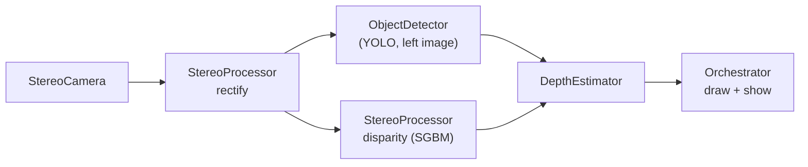

# Depth Estimator

Detects objects with **YOLO** and measures how far away each one is using a **stereo camera**.

A side-by-side stereo camera produces a left and a right image. The program rectifies them, runs YOLO on the left
image, computes a disparity map with OpenCV's SGBM matcher, and converts the disparity inside each detected box into a
distance (`Z = f * B / d`). A live window shows the boxes, their distances and the disparity map.

> **Status: work in progress.** The pipeline runs end to end and the worst silent failures (a broken detector, the
> unmeasurable left third of the frame, a wrong frame size) are fixed. Some problems can still give a plausible but wrong
> distance: new calibrations must declare `translation_unit="mm"`, but the application cannot verify that `T` really
> uses millimetres, and legacy files still assume mm with a warning. Read
> [Known problems](#known-problems) before trusting the numbers on your own setup.

## How it works



- YOLO and SGBM run **concurrently** on every frame and are joined before depth is computed, so a box and a disparity
  map always belong to the same frame.
- One distance is reported per box: the **median** of the valid disparities in the **central part** of the box, which
  keeps background pixels from dragging the estimate backwards.
- Each distance carries a `reliable` flag (green / orange `?` / red) so a doubtful value is visible.
- Failures are loud: a missing model, a detector error or a frame of the wrong size stops the program with a message.

Details: [Architecture](docs/architecture.md), [Depth estimation](docs/depth-estimation.md).

## Quick start

```bash
# 1. install from the repository root
pip install -e .

# 2. provide the two git-ignored files (see docs/setup.md for how)
#      depth_estimator/matrices/stereo_calib.npz    your stereo calibration
#      depth_estimator/models/yolov8n.pt            YOLO weights

# 3. check depth_estimator/config/*.yaml (camera device and resolution; device stays null so YOLO uses a GPU only if there is one)

# 4. run from the repository root
python -m depth_estimator.services.Orchestrator      # press q in the window to quit (or: estimate-depth)
```

Full instructions, the calibration file format, and a first-run checklist: [docs/setup.md](docs/setup.md).

## Project layout

```
DepthEstimator/
├── docs/                      documentation
│   └── problems/              one file per audited problem, plus evidence/ scripts that check each one
├── pyproject.toml             dependencies and the estimate-depth / tune-disparity commands
└── depth_estimator/
    ├── config/                YAML settings: camera, stereo processor, detector, depth estimator
    ├── exceptions/            YoloModelNotFound, DetectionError, DifferentImageSizeError
    ├── interfaces/ICamera.py  camera interface
    ├── services/              StereoCamera, StereoProcessor, ObjectDetector, DepthEstimator, Orchestrator
    ├── tuners/DisparityTuner.py   interactive SGBM tuning
    ├── utils/                 Configurator (reads and updates depth_estimator/config/*.yaml), DisparityVisualizer
    └── tests/
```

Not tracked by git (you provide them): `depth_estimator/matrices/stereo_calib.npz`, `depth_estimator/models/*.pt`, the sample images the tests use.

## Configuration at a glance

| File | Controls | Most important keys |
|---|---|---|
| `depth_estimator/config/stereo_camera.yaml` | the camera | `camera_index`, `combined_width`, `combined_height` |
| `depth_estimator/config/stereo_processor.yaml` | rectification and SGBM | `calibration_path`, `process_scale`, `matcher_params.numDisparities` |
| `depth_estimator/config/object_detector.yaml` | YOLO | `model_path`, `conf_threshold`, `device` |
| `depth_estimator/config/depth_estimator.yaml` | how a box becomes one distance | `roi_shrink`, `min_valid_frac`, `max_rel_spread` |

Every key is explained in [docs/configuration.md](docs/configuration.md). To tune the stereo matcher interactively
use the [tuning guide](docs/tuning-guide.md) (`python -m depth_estimator.tuners.DisparityTuner`).

## Documentation

| | |
|---|---|
| [Setup and running](docs/setup.md) | install, provide the calibration and model files, first-run checklist |
| [Architecture](docs/architecture.md) | pipeline, components, data contracts, coordinate spaces, threading, error model |
| [Configuration reference](docs/configuration.md) | every config key |
| [Depth estimation](docs/depth-estimation.md) | the maths, accuracy, working range, limitations |
| [Disparity tuning guide](docs/tuning-guide.md) | using `DisparityTuner` |
| [API reference](docs/api-reference.md) | classes, methods and exceptions |
| [Testing](docs/testing.md) | which tests exist, which ones run without hardware |
| [Known problems](docs/problems/README.md) | 13 audited problems with evidence, effects and fixes |

## Known problems

All problems were checked against the current code. **9 are fixed** (P01, P02, P03, P04, P05, P07, P10, P12, P13), **3 are partly
fixed** (P06, P08, P09), and **1 is mitigated**. The ones most likely to affect your numbers or your first run:

| | Problem | Effect |
|---|---|---|
| [P08](docs/problems/08-implicit-units.md) | New calibration files declare `T` in mm; legacy files assume mm with a warning | a mislabeled or incorrectly scaled calibration can still produce plausible wrong distances |

The full index, with severity and verification status, is [docs/problems/README.md](docs/problems/README.md). Each reproducible
problem has a script in [docs/problems/evidence/](docs/problems/evidence/README.md) that prints a `VERDICT` line.

## Testing

```bash
python -m pytest -q depth_estimator/tests/test_depth_estimator.py depth_estimator/tests/test_stereo_dead_band.py depth_estimator/tests/test_configurator.py depth_estimator/tests/test_stereo_calibration.py \
  depth_estimator/tests/test_stereo_camera.py::test_slow_consumer_gets_latest_frame \
  depth_estimator/tests/test_stereo_camera.py::test_frames_are_not_returned_twice \
  depth_estimator/tests/test_stereo_camera.py::test_release_stops_reader_thread \
  depth_estimator/tests/test_stereo_camera.py::test_camera_rejects_negotiated_resolution_mismatch  # 27 tests, no hardware needed
```

A plain `python -m pytest` collects 38 tests; 11 need a camera, a display, the model or the author's files. See
[docs/testing.md](docs/testing.md).
