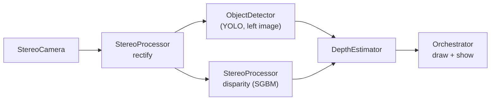

# Depth Estimator

Detects objects with **YOLO** and measures how far away each one is using a **stereo camera**.

A side-by-side stereo camera produces a left and a right image. The program rectifies them, runs YOLO on the left
image, computes a disparity map with OpenCV's SGBM matcher, and converts the disparity inside each detected box into a
distance (`Z = f * B / d`). A live window shows the boxes, their distances and the disparity map.

> **Status: work in progress.** The pipeline runs end to end, but there are documented problems that can
> produce a missing or wrong distance **without any error message**. Read [Known problems](#known-problems) before trusting
> the numbers on your own setup.

## How it works



- YOLO and SGBM run **concurrently** on every frame and are joined before depth is computed, so a box and a disparity
  map always belong to the same frame.
- One distance is reported per box: the **median** of the valid disparities in the **central part** of the box, which
  keeps background pixels from dragging the estimate backwards.
- Each distance carries a `reliable` flag (green / orange `?` / red) so a doubtful value is visible.

Details: [Architecture](docs/architecture.md), [Depth estimation](docs/depth-estimation.md).

## Quick start

```bash
# 1. dependencies (the repo has no requirements.txt yet)
pip install numpy opencv-python pyyaml ultralytics zope.interface pytest

# 2. provide the two git-ignored files (see docs/setup.md for how)
#      src/matrices/stereo_calib.npz    your stereo calibration
#      src/models/yolov8n.pt            YOLO weights

# 3. check config/*.yaml (camera device, resolution, device: null if you have no GPU)

# 4. run from the repository root
python -m src.services.Orchestrator      # press q in the window to quit
```

Full instructions, the calibration file format, and a first-run checklist: [docs/setup.md](docs/setup.md).

## Project layout

```
DepthEstimator/
├── config/                    YAML settings: camera, stereo processor, detector, depth estimator
├── docs/                      documentation
│   └── problems/              one file per known problem, plus evidence/ scripts that reproduce them
└── src/
    ├── interfaces/ICamera.py  camera interface
    ├── services/              StereoCamera, StereoProcessor, ObjectDetector, DepthEstimator, Orchestrator
    ├── tuners/DisparityTuner.py   interactive SGBM tuning
    ├── utils/Configurator.py  reads and updates config/*.yaml
    └── tests/
```

Not tracked by git (you provide them): `src/matrices/stereo_calib.npz`, `src/models/*.pt`.

## Configuration at a glance

| File | Controls | Most important keys |
|---|---|---|
| `config/stereo_camera.yaml` | the camera | `camera_index`, `combined_width`, `combined_height` |
| `config/stereo_processor.yaml` | rectification and SGBM | `calibration_path`, `process_scale`, `matcher_params.numDisparities` |
| `config/object_detector.yaml` | YOLO | `model_path`, `conf_threshold`, `device` |
| `config/depth_estimator.yaml` | how a box becomes one distance | `roi_shrink`, `min_valid_frac`, `max_rel_spread` |

Every key is explained in [docs/configuration.md](docs/configuration.md). To tune the stereo matcher interactively
use the [tuning guide](docs/tuning-guide.md).

## Documentation

| | |
|---|---|
| [Setup and running](docs/setup.md) | install, provide the calibration and model files, first-run checklist |
| [Architecture](docs/architecture.md) | pipeline, components, data contracts, coordinate spaces, threading |
| [Configuration reference](docs/configuration.md) | every config key |
| [Depth estimation](docs/depth-estimation.md) | the maths, accuracy, working range, limitations |
| [Disparity tuning guide](docs/tuning-guide.md) | using `DisparityTuner` |
| [API reference](docs/api-reference.md) | classes and methods |
| [Testing](docs/testing.md) | which tests exist and which ones mean something |
| [Known problems](docs/problems/README.md) | 11 problems with evidence, effects and fixes |

## Known problems

Found by reading the whole repository and then testing each suspicion. The four most important:

| | Problem | Effect |
|---|---|---|
| [P01](docs/problems/01-sgbm-dead-band.md) | With `numDisparities: 320`, the left 33% of the frame can never get a depth | objects there show "no depth" |
| [P02](docs/problems/02-frame-size-vs-calibration.md) | A frame size that differs from the calibration is rectified without error | mostly-black input, plausible-looking wrong depths |
| [P03](docs/problems/03-invalid-disparity-assumes-min-disparity-zero.md) | `minDisparity ≥ 1` turns "no match" into a valid-looking disparity | confident wrong depth (latent: default is 0) |
| [P04](docs/problems/04-silent-detector-failure.md) | A detector that fails looks like an empty scene | no boxes, no error |

All eleven, with severity and verification status, are in [docs/problems/README.md](docs/problems/README.md). Each
reproducible one has a script in [docs/problems/evidence/](docs/problems/evidence/README.md).

## Testing

```bash
python -m pytest -q                          # 2 tests are discovered today (see docs/testing.md)
python -m src.tests.DepthEstimatorTest       # 10 hardware-free tests of the depth math
```
