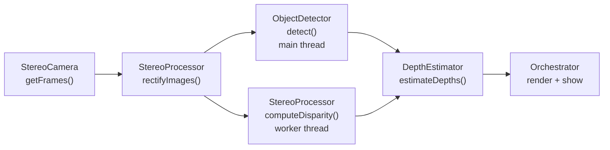

# Architecture

## What the program does

It reads frames from a side-by-side stereo camera, finds objects with YOLO, and reports how far away each
object is by using the disparity between the left and right views.

## The pipeline (one frame)



1. **Capture.** `StereoCamera` reads one combined frame (for example 3840x1080) and splits it into a left and a right image.
2. **Rectify.** `StereoProcessor` remaps both images so that a point has the *same row* in both. The matching problem
   becomes one-dimensional.
3. **In parallel**
   - `ObjectDetector` runs YOLO on the **rectified left** image only and returns bounding boxes.
   - `StereoProcessor` runs SGBM on the rectified pair and returns a **disparity map** (at `process_scale`).
4. **Join.** The orchestrator waits for both. Only then does `DepthEstimator` look up each box in the disparity
   map. A box and a disparity map therefore always come from the same frame.
5. **Show.** The orchestrator draws boxes, depths and the disparity map on *copies* of the frame.

Why detect on the left image only: after rectification the left image and the disparity map share a coordinate
system (SGBM computes disparity for the left image), so a left-image box indexes straight into the disparity map.

## Components

| Component | File | Responsibility | Knows about |
|---|---|---|---|
| `StereoCamera` | `src/services/StereoCamera.py` | open the camera, grab and split frames | OpenCV only |
| `StereoProcessor` | `src/services/StereoProcessor.py` | load calibration, rectify, compute disparity, expose focal length and baseline | calibration file, SGBM settings |
| `ObjectDetector` | `src/services/ObjectDetector.py` | run YOLO, return plain dictionaries | ultralytics |
| `DepthEstimator` | `src/services/DepthEstimator.py` | turn *(disparity map, boxes)* into depths | nothing else: pure math |
| `Orchestrator` | `src/services/Orchestrator.py` | build the components from config, run the loop, thread, time, draw | all of the above |
| `Configurator` | `src/utils/Configurator.py` | read and update `config/*.yaml` | file locations |
| `DisparityTuner` | `src/tuners/DisparityTuner.py` | interactive SGBM tuning with live preview | `StereoProcessor`, `StereoCamera` |
| `ICamera` | `src/interfaces/ICamera.py` | camera interface (`zope.interface`) | |

Design rule: **`DepthEstimator` has no dependency on the camera, the calibration file or YOLO.** Everything it needs is
passed to its constructor, so it can be tested with a synthetic disparity map
(see [Testing](testing.md)).

## Data that moves between components

**Detection** (from `ObjectDetector.detect`)

```python
{"box": [x1, y1, x2, y2],   # floats, pixels of the rectified LEFT image at FULL resolution
 "conf": 0.87, "cls": 0, "name": "person"}
```

**Disparity map** (from `StereoProcessor.computeDisparity`): `float32`, shape `(H * process_scale, W * process_scale)`,
values in pixels **of the downscaled image**. Pixels SGBM could not match are `minDisparity - 1`
(`-1` when `minDisparity` is 0). See [P03](problems/03-invalid-disparity-assumes-min-disparity-zero.md).

**Depth result** (from `DepthEstimator`, one per detection, or `None`)

```python
{"z_mm": 750.0,        # distance, in the unit of the calibration square size (assumed mm)
 "disparity": 40.0,    # median disparity used (downscaled pixels)
 "valid_frac": 1.0,    # share of sampled pixels that had a valid disparity
 "rel_spread": 0.0,    # (75th - 25th percentile) / median
 "reliable": True,     # heuristic flag, see depth-estimation.md
 "roi": (x1, y1, x2, y2)}   # region sampled, FULL-resolution pixels (for drawing)
```

**`Orchestrator.processFrame()`** returns
`{rect_left, disparity, detections, depths, yolo_ms, sgbm_ms}`.

## Coordinate spaces (the part that is easy to get wrong)

| Stage | Size (example) | Notes |
|---|---|---|
| Combined camera frame | 3840 x 1080 | `combined_width x combined_height` |
| Left / right halves | 1920 x 1080 each | split at `width // 2` |
| Rectified images | `img_size` from the calibration | **must equal the half-frame size** ([P02](problems/02-frame-size-vs-calibration.md)) |
| YOLO boxes | same as rectified left (full resolution) | |
| Disparity map | 960 x 540 at `process_scale: 0.5` | smaller, for speed |

`DepthEstimator` bridges the last two: it multiplies the box by `process_scale` to index the disparity map, and uses
`focal_length * process_scale` in the depth formula.

## Threading model

```
main thread :  rectify --> submit(SGBM) --> YOLO ----------------> join --> depth --> draw
worker      :                              \--- SGBM --------------/
```

- A `ThreadPoolExecutor(max_workers=1)` runs SGBM while YOLO runs on the main thread. OpenCV and PyTorch release
  Python's GIL during heavy work, so they genuinely overlap.
- Frame time is about `max(yolo, sgbm)` instead of `yolo + sgbm`. This holds when they use different hardware
  (YOLO on the GPU, SGBM on the CPU). If both fight for the CPU the gain shrinks.
- The SGBM timer lives **inside** the worker so it measures SGBM's real cost, not how long the main thread waited.
- It is a **fork-join per frame**, not free-running threads. That is deliberate: free-running stages would pair
  boxes from frame N with a disparity map from frame N-3 and produce plausible but wrong depths.
- `future.result()` re-raises exceptions from the worker, so SGBM errors surface in the main thread.

## Error-handling model (current behaviour)

Several components catch broad exceptions, print a message, and carry on (`ObjectDetector`, `StereoCamera.open`,
`Configurator.fetchData`). The consequence is that some failures are silent; see
[P04](problems/04-silent-detector-failure.md) and [P09](problems/09-configurator-error-handling-and-rewrites.md).
